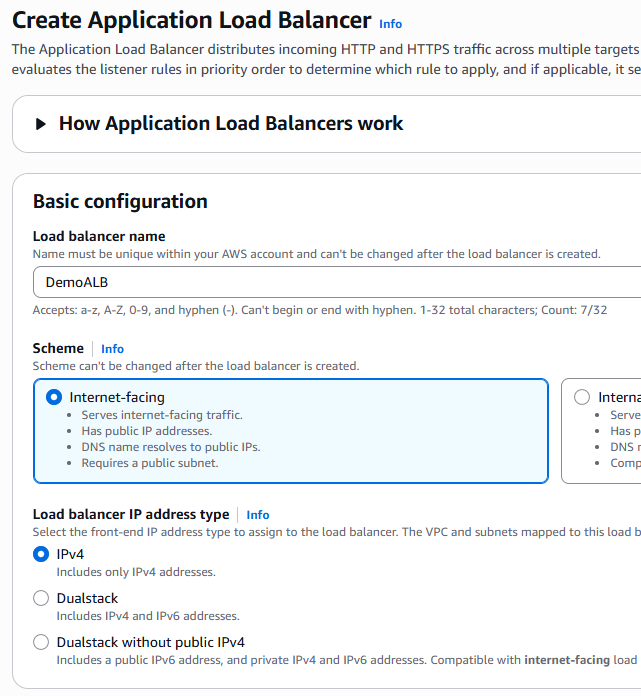
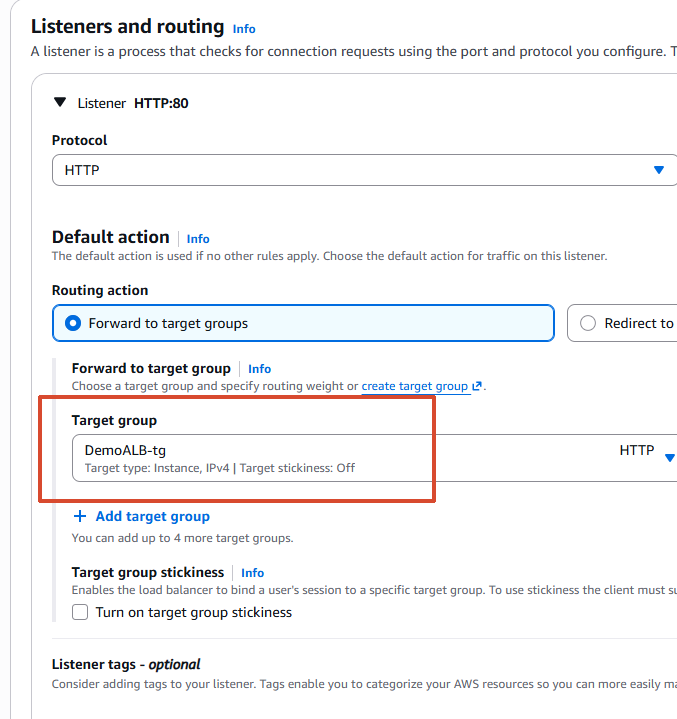
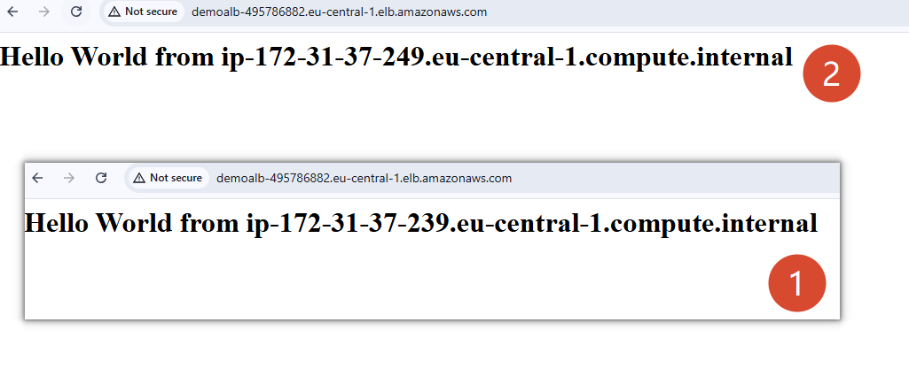
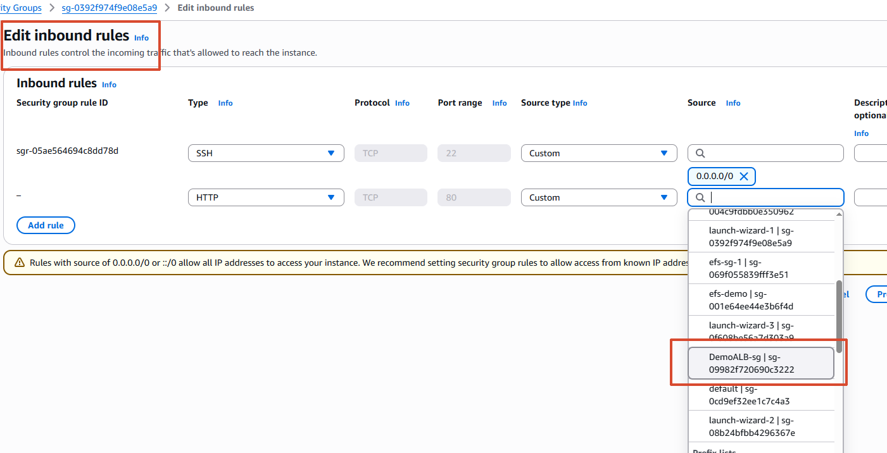
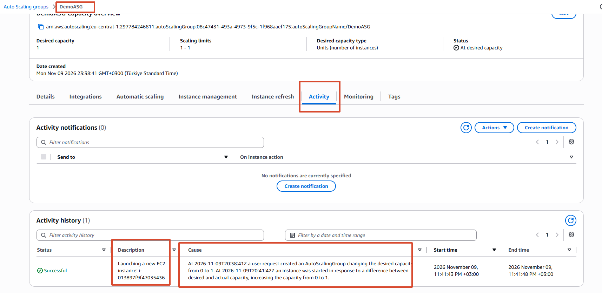
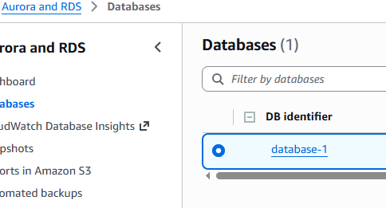

# 03-ELB-and-ASG

## Prepare EC2 instances

Create two EC2 instances to use as targets behind a load balancer.

## Application Load Balancer

Create an Application Load Balancer, select the Availability Zones, configure its security group, and create a target group.

Access the application through the load balancer.

Update the EC2 security group so that inbound application traffic is allowed only from the ALB security group.

## Auto Scaling Group

Create an Auto Scaling Group and observe it launch EC2 instances based on its configuration.

Configure scaling policies to adjust the desired capacity based on defined conditions.

## Amazon RDS

Create an RDS database and connect to it using SQL Electron.

---
